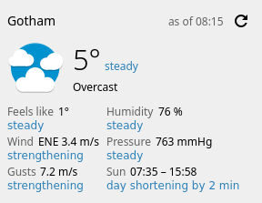

# Weather Widget

A KDE Plasma 6 panel widget showing the weather from [Open-Meteo](https://open-meteo.com): current conditions, an hourly forecast for the next 24 hours and a 7-day forecast. No API key, no helper services – a single plasmoid in plain QML.

Tags: `kde-plasma` · `plasmoid` · `wayland` · `weather` · `open-meteo` · `qml`

Русская версия: [ПРОЧТИ.md](ПРОЧТИ.md)


With both forecasts switched off in the settings the popup shrinks to current conditions:



The images are renders of the popup made without a desktop session (`plasmawindowed` on the offscreen platform), not screenshots of a real panel: fonts, icons and colours follow your Plasma theme.

## Why

The stock Plasma weather widget takes its data from a handful of national weather services, and most of them cover only their own country. For many places that leaves a single provider, which reports observations from the nearest weather station: the station may be far from the place itself, and its readings may be several hours old. The place is picked from the provider's list, so a location that is not on the list cannot be set at all. Open-Meteo gives a model-based value for any coordinates, refreshed every 15 minutes.

## What it shows

- **Panel:** weather icon and temperature. The width is fixed by the layout, so the widget does not overlap its neighbours.
- **Current conditions:** temperature, description, feels-like, wind direction and speed, gusts, humidity, pressure (at station level, not reduced to sea level), sunrise and sunset. A trend word in blue is shown next to the temperature and below feels-like, humidity, wind, gusts and pressure: "rising"/"falling" (for wind "strengthening"/"easing") or "steady". The forecast one hour ahead is compared with the current value; a change below the threshold counts as "steady". The horizon and the thresholds are configurable. Below sunrise and sunset the change of day length by tomorrow is shown ("day shortening by 2 min").
- **Next 24 hours:** two rows of 12 hours with icon, temperature and precipitation probability.
- **7 days:** description, precipitation probability and amount, minimum and maximum temperature.

The interface follows the system language: English by default, Russian when Plasma is set to Russian. Units are metric by default (°C, m/s, mmHg, mm) and can be changed in the settings.

## How it works

- `contents/ui/main.qml` requests the Open-Meteo forecast API with `XMLHttpRequest` and renders both representations.
- `contents/ui/weather.js` maps WMO weather codes to descriptions and Breeze icon names and converts the response into the structure used by the layout.
- Instead of one long timer the widget checks the clock every minute: data is refreshed once the configured interval has passed, one minute after a failed request, and within a minute after resume from suspend. A request without an answer is aborted after 30 seconds. Data older than two hours is dimmed on the panel.
- Strings go through `i18n()` with English as the source language. The Russian catalogue is `po/ru.po`; `build-translations.sh` compiles it into `contents/locale/ru/LC_MESSAGES/plasma_applet_org.elph.weather.mo` (`install.sh` does this automatically when gettext is present). To add a language, put `po/<lang>.po` next to it.

## Settings

Place name, latitude, longitude (decimal degrees) and the update interval in minutes (15 by default). Units are chosen separately for temperature (°C, °F), wind speed (m/s, km/h, mph, knots), pressure (mmHg, hPa, inHg) and precipitation (mm, inches); changing them does not trigger a new request, the last response is converted on the spot. Two checkboxes, both on by default, show or hide the 24-hour and the 7-day forecast; with both off the popup shrinks to current conditions only, and the details move below the temperature. The "Trends" section sets how many hours ahead the forecast is compared with the current value (1 by default, up to 12) and the thresholds: temperature 0.5 °C, humidity 3 %, wind 0.5 m/s, gusts 1 m/s, pressure 0.5 hPa by default. Thresholds are always in these units, whatever display units are chosen. There is no search by city name: coordinates are entered by hand. The default coordinates are only an example: set your own after adding the widget.

## Installation

```
./install.sh
```

The script installs or updates the package `org.elph.weather` in `~/.local/share/plasma/plasmoids/` with `kpackagetool6`. Then add the widget «Погода» via "Add Widgets…". After an update restart the shell: `systemctl --user restart plasma-plasmashell.service`.

Requires KDE Plasma 6. Developed and used on Plasma 6.8.

## Data

Weather data by [Open-Meteo](https://open-meteo.com), licensed under CC BY 4.0. The free API is intended for non-commercial use.
