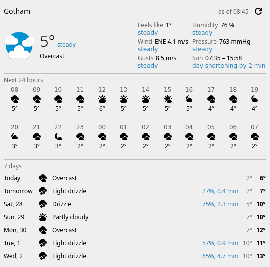
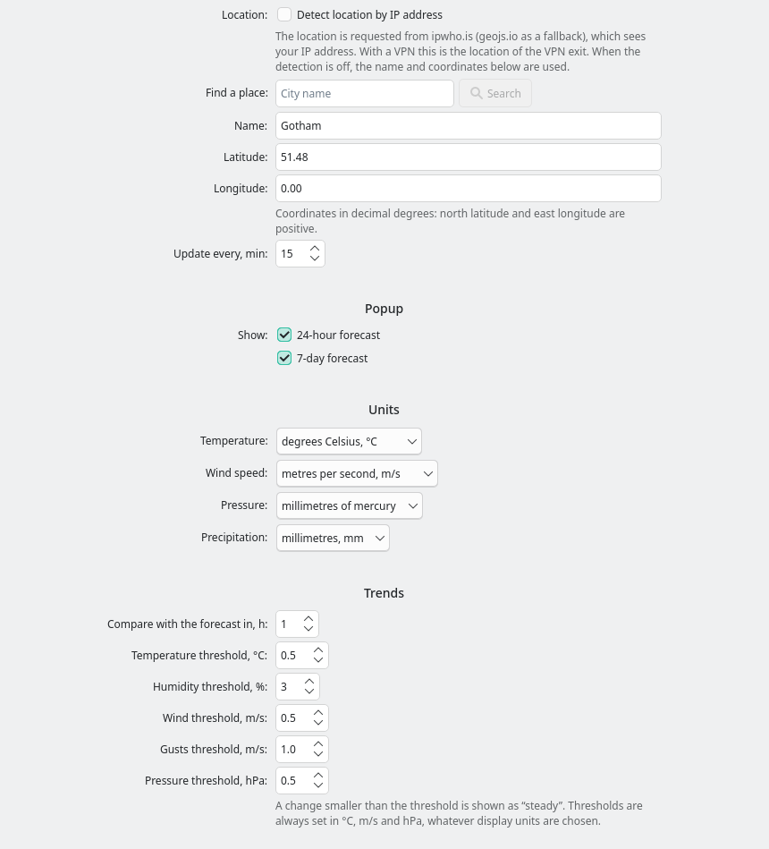

# Weather Widget

A KDE Plasma 6 panel widget showing the weather from [Open-Meteo](https://open-meteo.com): current conditions, an hourly forecast for the next 24 hours and a 7-day forecast. No API key, no helper services on your machine – a single plasmoid in plain QML.

Tags: `kde-plasma` · `plasmoid` · `wayland` · `weather` · `open-meteo` · `qml`

Русская версия: [ПРОЧТИ.md](ПРОЧТИ.md)

In the panel:


The popup:



With both forecasts switched off in the settings the popup shrinks to current conditions:


The settings:



The images are renders made without a desktop session (on the Qt offscreen platform), not screenshots of a real desktop: fonts, icons and colours follow your Plasma theme, and the settings page is shown without the frame of its dialog.

## Why

The stock Plasma weather widget takes its data from a handful of national weather services, and most of them cover only their own country. For many places that leaves a single provider, which reports observations from the nearest weather station: the station may be far from the place itself, and its readings may be several hours old. Open-Meteo gives a model-based value for any coordinates, refreshed every 15 minutes.

## What it shows

- **Panel:** weather icon and temperature. The width is fixed by the layout, so the widget does not overlap its neighbours.
- **Current conditions:** temperature, description, feels-like, wind direction and speed, gusts, humidity, pressure (at station level, not reduced to sea level), sunrise and sunset. A trend word in blue is shown next to the temperature and below feels-like, humidity, wind, gusts and pressure: "rising"/"falling" (for wind "strengthening"/"easing") or "steady". The forecast one hour ahead is compared with the current value; a change below the threshold counts as "steady". The horizon and the thresholds are configurable. Below sunrise and sunset the change of day length by tomorrow is shown ("day shortening by 2 min").
- **Next 24 hours:** two rows of 12 hours with icon, temperature and precipitation probability.
- **7 days:** description, precipitation probability and amount, minimum and maximum temperature.

The interface follows the system language: English by default, Russian when Plasma is set to Russian. Units are metric by default (°C, m/s, mmHg, mm) and can be changed in the settings.

## How it works

- `contents/ui/main.qml` detects the location (unless it is set by hand), requests the Open-Meteo forecast API with `XMLHttpRequest` and renders both representations.
- `contents/ui/weather.js` maps WMO weather codes to descriptions and Breeze icon names, computes the trends and converts the response into the structure used by the layout.
- Instead of one long timer the widget checks the clock every minute: data is refreshed once the configured interval has passed, one minute after a failed request, and within a minute after resume from suspend. A request without an answer is aborted after 30 seconds. Data older than two hours is dimmed on the panel.
- Strings go through `i18n()` with English as the source language. The Russian catalogue is `po/ru.po`; `build-translations.sh` compiles it into `contents/locale/ru/LC_MESSAGES/plasma_applet_org.elph.weather.mo` (`install.sh` does this automatically when gettext is present). To add a language, put `po/<lang>.po` next to it.

## Settings

- **Location.** The place name, latitude and longitude (decimal degrees). A place can be found by name: the search asks the Open-Meteo geocoder and fills in the name and coordinates of the chosen result; they can also be typed by hand. The defaults are a neutral example (Greenwich), so set your own place after adding the widget.
- **Detection by IP address.** Off by default. With the "Detect location by IP address" checkbox on, the widget asks ipwho.is (geojs.io as a fallback), then the Open-Meteo geocoder for the place name in the system language. Detection is repeated every three hours and when the refresh button is pressed. With a VPN the result is the location of the VPN exit.
- **Update interval** in minutes, 15 by default.
- **Popup.** Two checkboxes, both on by default, show or hide the 24-hour and the 7-day forecast. With both off the popup shrinks to current conditions, and the details move below the temperature.
- **Units**, chosen separately: temperature (°C, °F), wind speed (m/s, km/h, mph, knots), pressure (mmHg, hPa, inHg), precipitation (mm, inches). Changing them does not trigger a new request: the last response is converted on the spot.
- **Trends.** How many hours ahead the forecast is compared with the current value (1 by default, up to 12) and the thresholds: temperature 0.5 °C, humidity 3 %, wind 0.5 m/s, gusts 1 m/s, pressure 0.5 hPa by default. Thresholds are always in these units, whatever display units are chosen.

If the coordinates are empty or the detection fails, the popup shows a message and a button that opens the settings.

## Installation

Requires KDE Plasma 6; tested on Plasma 6.8.

### From a package

Download `org.elph.weather-<version>.plasmoid` from the [releases page](../../releases/latest) and install it:

```
kpackagetool6 -t Plasma/Applet -i org.elph.weather-<version>.plasmoid
```

To update an installed widget use `-u` instead of `-i`. The same file can be installed without a terminal: "Add Widgets…" → "Get New Widgets…" → "Install Widget From Local File…".

Then add the widget "Weather" via "Add Widgets…" and set your place in its settings. After an update restart the shell: `systemctl --user restart plasma-plasmashell.service`.

To remove the widget: `kpackagetool6 -t Plasma/Applet -r org.elph.weather`.

### From source

```
./install.sh
```

The script installs or updates the package in `~/.local/share/plasma/plasmoids/` straight from the repository. `./build-package.sh` builds `dist/org.elph.weather-<version>.plasmoid`, the file published in releases; it needs Python 3. Rebuilding the translation needs gettext (`msgfmt`); without it the catalogue shipped in the package is installed.

## Data and privacy

Weather data by [Open-Meteo](https://open-meteo.com), licensed under CC BY 4.0. The free API is intended for non-commercial use.

The widget talks only to the services named here. Open-Meteo receives the coordinates of the place. Detection by IP address is off by default; when it is turned on, [ipwho.is](https://ipwho.is) or, as a fallback, [geojs.io](https://www.geojs.io) sees your IP address, and the Open-Meteo geocoder receives the name of the detected place. Otherwise only the forecast request is made. The place search in the settings sends the typed name to the Open-Meteo geocoder.

## License

[MIT](LICENSE). The weather data has its own licence, see above.
