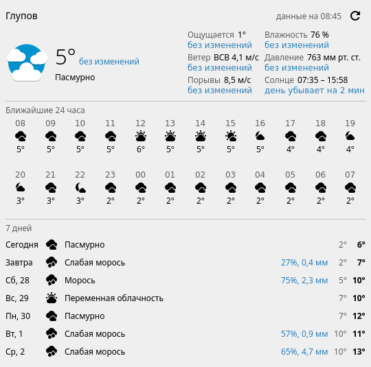
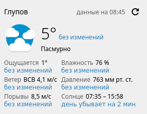

# Виджет погоды

Виджет панели KDE Plasma 6, показывающий погоду по данным [Open-Meteo](https://open-meteo.com): текущее состояние, почасовой прогноз на сутки и прогноз на 7 дней. Без ключа API и без вспомогательных служб на вашей машине – один плазмоид на чистом QML.

Теги: `kde-plasma` · `plasmoid` · `wayland` · `weather` · `open-meteo` · `qml`

English version: [README.md](README.md)



Если в настройках отключить оба прогноза, окно сужается до текущей погоды:



Изображения – отрисовка раскрытого вида без рабочего стола (`plasmawindowed` на платформе offscreen), а не снимки настоящей панели: шрифты, значки и цвета зависят от вашей темы Plasma.

## Зачем

Штатный виджет погоды Plasma берёт данные у нескольких национальных метеослужб, и большинство из них охватывает только свою страну. Для многих мест остаётся единственный источник, который отдаёт наблюдения ближайшей метеостанции: станция может находиться далеко от самого места, а её показания – быть давностью в несколько часов. Место выбирается из списка источника, поэтому задать точку, которой в списке нет, нельзя вовсе. Open-Meteo даёт расчётное значение для любых координат и обновляет его каждые 15 минут.

## Что показывает

- **В панели:** значок погоды и температура. Ширина закреплена вёрсткой, поэтому виджет не наезжает на соседей.
- **Текущая погода:** температура, описание, «ощущается», направление и скорость ветра, порывы, влажность, давление (на уровне места, без приведения к уровню моря), восход и закат. Рядом с температурой и под показателями «ощущается», влажность, ветер, порывы и давление синим выводится тенденция: «повышается»/«понижается» (для ветра «усиливается»/«стихает») или «без изменений». Прогноз на час вперёд сравнивается с текущим значением; изменение меньше порога считается отсутствием изменений. Срок и пороги задаются в настройках. Под восходом и закатом выводится изменение долготы дня к завтрашнему дню («день убывает на 2 мин»).
- **Ближайшие 24 часа:** два ряда по 12 часов со значком, температурой и вероятностью осадков.
- **7 дней:** описание, вероятность и сумма осадков, минимальная и максимальная температура.

Язык интерфейса следует языку системы: по умолчанию английский, при русском языке Plasma – русский. Единицы по умолчанию метрические (°C, м/с, мм рт. ст., мм), их можно сменить в настройках.

## Как это устроено

- `contents/ui/main.qml` запрашивает прогноз у Open-Meteo через `XMLHttpRequest` и рисует оба вида виджета.
- `contents/ui/weather.js` сопоставляет коды погоды ВМО с описаниями и значками темы Breeze и приводит ответ сервиса к виду, удобному для вёрстки.
- Вместо одного длинного таймера виджет раз в минуту сверяется с часами: данные обновляются по истечении заданного интервала, через минуту после неудачного запроса и в течение минуты после выхода из сна. Запрос без ответа обрывается через 30 секунд. Данные старше двух часов на панели бледнеют.
- Строки проходят через `i18n()`, исходный язык – английский. Русский каталог лежит в `po/ru.po`; `build-translations.sh` собирает его в `contents/locale/ru/LC_MESSAGES/plasma_applet_org.elph.weather.mo` (`install.sh` делает это сам, если установлен gettext). Чтобы добавить язык, достаточно положить рядом `po/<язык>.po`.

## Настройки

Место и интервал обновления в минутах (по умолчанию 15). По умолчанию место определяется по IP-адресу: виджет обращается к ipwho.is (запасной сервис – geojs.io), который видит ваш IP-адрес, а затем к геокодеру Open-Meteo за названием места на языке системы. Место определяется заново раз в три часа и по кнопке обновления; при работе через VPN это будет место выхода VPN. Если снять галку «Определение местоположения по IP-адресу», действуют название места, широта и долгота (в десятичных градусах) из настроек; по умолчанию там условный пример (Гринвич). Если координаты пусты или определить место не удалось, в раскрытом виде выводится сообщение и кнопка, открывающая настройки. Единицы измерения выбираются отдельно для температуры (°C, °F), скорости ветра (м/с, км/ч, мили в час, узлы), давления (мм рт. ст., гПа, дюймы рт. ст.) и осадков (мм, дюймы); смена единиц не вызывает нового запроса, пересчитывается последний ответ. Две галки, по умолчанию включённые, показывают или скрывают прогноз на 24 часа и на 7 дней; без обоих прогнозов окно сужается до текущей погоды, а показатели переходят под температуру. В разделе «Тенденции» задаются срок сравнения прогноза с текущим значением (по умолчанию 1 час, до 12) и пороги: по умолчанию температура 0,5 °C, влажность 3 %, ветер 0,5 м/с, порывы 1 м/с, давление 0,5 гПа. Пороги всегда задаются в этих единицах, какие бы единицы отображения ни были выбраны. Поиска по названию города нет: при отключённом определении координаты вводятся вручную.

## Установка

```
./install.sh
```

Сценарий ставит или обновляет пакет `org.elph.weather` в `~/.local/share/plasma/plasmoids/` средствами `kpackagetool6`. После этого виджет «Погода» добавляется через «Добавить виджеты…». После обновления нужно перезапустить оболочку: `systemctl --user restart plasma-plasmashell.service`.

Требуется KDE Plasma 6. Разработан и используется на Plasma 6.8.

## Данные

Данные о погоде – [Open-Meteo](https://open-meteo.com), лицензия CC BY 4.0. Бесплатный API предназначен для некоммерческого использования.
