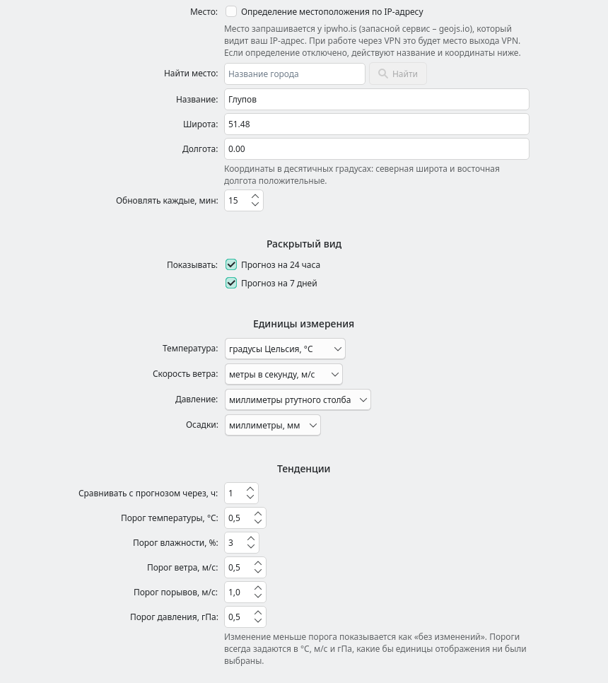

# Виджет погоды

Виджет панели KDE Plasma 6, показывающий погоду по данным [Open-Meteo](https://open-meteo.com): текущее состояние, почасовой прогноз на сутки и прогноз на 7 дней. Без ключа API и без вспомогательных служб на вашей машине – один плазмоид на чистом QML.

Теги: `kde-plasma` · `plasmoid` · `wayland` · `weather` · `open-meteo` · `qml`

English version: [README.md](README.md)

В панели:


Раскрытый вид:


Если в настройках отключить оба прогноза, окно сужается до текущей погоды:


Настройки:



Изображения – отрисовка без рабочего стола (на платформе Qt offscreen), а не снимки настоящего экрана: шрифты, значки и цвета зависят от вашей темы Plasma, а страница настроек показана без рамки своего окна.

## Зачем

Штатный виджет погоды Plasma берёт данные у нескольких национальных метеослужб, и большинство из них охватывает только свою страну. Для многих мест остаётся единственный источник, который отдаёт наблюдения ближайшей метеостанции: станция может находиться далеко от самого места, а её показания – быть давностью в несколько часов. Open-Meteo даёт расчётное значение для любых координат и обновляет его каждые 15 минут.

## Что показывает

- **В панели:** значок погоды и температура. Ширина закреплена вёрсткой, поэтому виджет не наезжает на соседей.
- **Текущая погода:** температура, описание, «ощущается», направление и скорость ветра, порывы, влажность, давление (на уровне места, без приведения к уровню моря), восход и закат. Рядом с температурой и под показателями «ощущается», влажность, ветер, порывы и давление синим выводится тенденция: «повышается»/«понижается» (для ветра «усиливается»/«стихает») или «без изменений». Прогноз на час вперёд сравнивается с текущим значением; изменение меньше порога считается отсутствием изменений. Срок и пороги задаются в настройках. Под восходом и закатом выводится изменение долготы дня к завтрашнему дню («день убывает на 2 мин»).
- **Ближайшие 24 часа:** два ряда по 12 часов со значком, температурой и вероятностью осадков.
- **7 дней:** описание, вероятность и сумма осадков, минимальная и максимальная температура.

Язык интерфейса следует языку системы: по умолчанию английский, при русском языке Plasma – русский. Единицы по умолчанию метрические (°C, м/с, мм рт. ст., мм), их можно сменить в настройках.

## Как это устроено

- `contents/ui/main.qml` определяет место (если оно не задано вручную), запрашивает прогноз у Open-Meteo через `XMLHttpRequest` и рисует оба вида виджета.
- `contents/ui/weather.js` сопоставляет коды погоды ВМО с описаниями и значками темы Breeze, вычисляет тенденции и приводит ответ сервиса к виду, удобному для вёрстки.
- Вместо одного длинного таймера виджет раз в минуту сверяется с часами: данные обновляются по истечении заданного интервала, через минуту после неудачного запроса и в течение минуты после выхода из сна. Запрос без ответа обрывается через 30 секунд. Данные старше двух часов на панели бледнеют.
- Строки проходят через `i18n()`, исходный язык – английский. Русский каталог лежит в `po/ru.po`; `build-translations.sh` собирает его в `contents/locale/ru/LC_MESSAGES/plasma_applet_org.elph.weather.mo` (`install.sh` делает это сам, если установлен gettext). Чтобы добавить язык, достаточно положить рядом `po/<язык>.po`.

## Настройки

- **Место.** Название места, широта и долгота (в десятичных градусах). Место можно найти по названию: поиск обращается к геокодеру Open-Meteo и подставляет название и координаты выбранного результата; их можно ввести и вручную. По умолчанию задан условный пример (Гринвич), поэтому после добавления виджета укажите своё место.
- **Определение по IP-адресу.** По умолчанию выключено. Если поставить галку «Определение местоположения по IP-адресу», виджет обращается к ipwho.is (запасной сервис – geojs.io), затем к геокодеру Open-Meteo за названием места на языке системы. Определение повторяется раз в три часа и по кнопке обновления. При работе через VPN получится место выхода VPN.
- **Интервал обновления** в минутах, по умолчанию 15.
- **Раскрытый вид.** Две галки, по умолчанию включённые, показывают или скрывают прогноз на 24 часа и на 7 дней. Без обоих прогнозов окно сужается до текущей погоды, а показатели переходят под температуру.
- **Единицы измерения**, выбираются отдельно: температура (°C, °F), скорость ветра (м/с, км/ч, мили в час, узлы), давление (мм рт. ст., гПа, дюймы рт. ст.), осадки (мм, дюймы). Смена единиц не вызывает нового запроса: пересчитывается последний ответ.
- **Тенденции.** Срок сравнения прогноза с текущим значением (по умолчанию 1 час, до 12) и пороги: по умолчанию температура 0,5 °C, влажность 3 %, ветер 0,5 м/с, порывы 1 м/с, давление 0,5 гПа. Пороги всегда задаются в этих единицах, какие бы единицы отображения ни были выбраны.

Если координаты пусты или определить место не удалось, в раскрытом виде выводится сообщение и кнопка, открывающая настройки.

## Установка

Требуется KDE Plasma 6; проверено на Plasma 6.8.

### Из пакета

Скачайте `org.elph.weather-<версия>.plasmoid` со [страницы релизов](../../releases/latest) и установите:

```
kpackagetool6 -t Plasma/Applet -i org.elph.weather-<версия>.plasmoid
```

Для обновления уже установленного виджета вместо `-i` указывается `-u`. Тот же файл ставится и без терминала: «Добавить виджеты…» → «Загрузить виджеты…» → «Установить виджет из файла…».

После этого виджет «Погода» добавляется через «Добавить виджеты…»; своё место задаётся в его настройках. После обновления нужно перезапустить оболочку: `systemctl --user restart plasma-plasmashell.service`.

Удаление виджета: `kpackagetool6 -t Plasma/Applet -r org.elph.weather`.

### Из исходников

```
./install.sh
```

Сценарий ставит или обновляет пакет в `~/.local/share/plasma/plasmoids/` прямо из репозитория. `./build-package.sh` собирает `dist/org.elph.weather-<версия>.plasmoid` – файл, который публикуется в релизах; для него нужен Python 3. Для пересборки перевода нужен gettext (`msgfmt`); без него ставится каталог, уже лежащий в пакете.

## Данные и приватность

Данные о погоде – [Open-Meteo](https://open-meteo.com), лицензия CC BY 4.0. Бесплатный API предназначен для некоммерческого использования.

Виджет обращается только к названным здесь сервисам. Open-Meteo получает координаты места. Определение по IP-адресу по умолчанию выключено; если его включить, ваш IP-адрес видит [ipwho.is](https://ipwho.is) или, как запасной, [geojs.io](https://www.geojs.io), а геокодер Open-Meteo получает название определённого места. Иначе выполняется только запрос прогноза. Поиск места в настройках отправляет введённое название геокодеру Open-Meteo.

## Лицензия

[MIT](LICENSE). У данных о погоде своя лицензия, см. выше.
